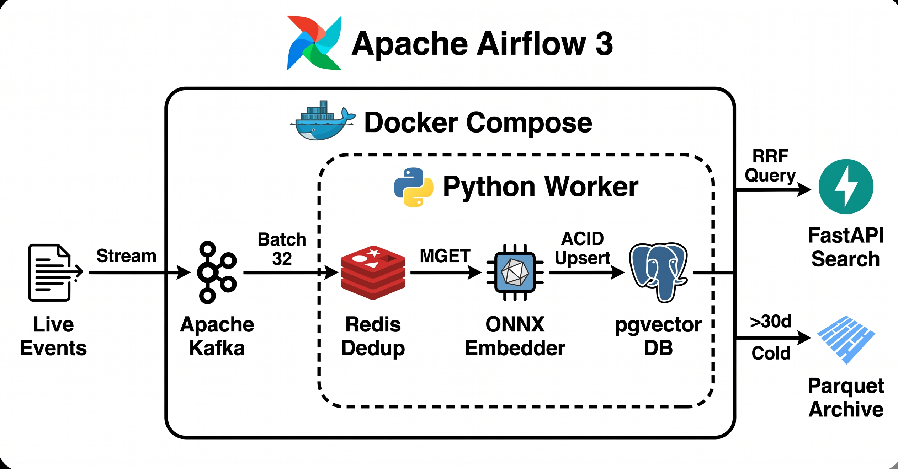

# StreamVec — Real-Time Hybrid RAG & Streaming Vector Pipeline

> Live sources → **Apache Kafka 3.8 (KRaft)** (topics + DLQ) → **Python Stream Worker** (Redis SHA-256 dedup + semantic chunking + ONNX micro-batch embeddings) → **PostgreSQL 16 + `pgvector`** (HNSW + GIN Hybrid Search) → **FastAPI** (Reciprocal Rank Fusion) & **Apache Airflow 3** (MRR/Hit@5 Drift Gate + Cold Parquet Archival).

---

## Architecture



---

## Measured Engineering Benchmarks

*Test Environment: Docker Compose on 6-core AMD Ryzen 5 CPU, 8GB RAM budget (`KAFKA_HEAP_OPTS="-Xmx512M"`, PostgreSQL `shared_buffers=512MB`, `batch_size=32`, `BAAI/bge-small-en-v1.5` 384d ONNX).*

| Metric | Measured Result | Source of Truth |
| --- | --- | --- |
| **Stream Volume & Scale** | **50,100** events consumed · **30,337** unique docs / chunks indexed (384d) | PostgreSQL `documents` & `document_chunks` |
| **Dedup Compute Saved** | **39.7%** skipped (**19,867 / 50,100** duplicate events bypassed ONNX) | Redis `MGET` + Worker JSON counters |
| **Micro-Batch Throughput** | **42.4 docs/s** (`batch=1`) → **58.4 docs/s** (`batch=32`, **1.38×** speedup) | `scripts/benchmark.py` ONNX benchmark |
| **Hybrid RRF Query Latency** | **48.29 ms** DB execution (`idx_chunks_hnsw` + `idx_chunks_gin` verified) | `EXPLAIN (ANALYZE, BUFFERS)` |
| **End-to-End API Latency** | **50.69 ms** avg Hybrid RRF · **24.64 ms** avg Vector-Only (30 queries) | FastAPI `/search` telemetry |
| **Retrieval Quality (MRR & Hit@5)** | **0.9333** (Vector-Only) → **0.9667** (Hybrid RRF, **+3.58% MRR lift**) | Airflow 3 30-query golden-set eval |
| **DLQ Fault Isolation** | **100 / 100** malformed payloads quarantined · **0** worker crashes | `documents_dlq` Kafka offsets |

> **Engineering Note on Backlog Drain vs. Live Streaming Latency:** During the 50,100-event stress test, all events were pre-loaded into Kafka *before* starting the consumer, yielding a backlog drain `indexed_at - published_at` of `1,095s` (p50) / `2,010s` (p95) at `58.4 docs/s` sustained CPU throughput. Under continuous streaming arrival (below the `58.4 docs/s` CPU saturation ceiling), micro-batches commit within sub-second to ~1.5s latency.

---

## Why Hybrid RRF Beats Pure Vector Search

Dense embeddings capture conceptual intent well, but frequently blur exact identifiers (`CVE-2024-3094`, `ef_construction=64`, `k=60`). StreamVec fuses top-20 HNSW cosine candidates and top-20 GIN `ts_rank_cd` keyword candidates inside a single PostgreSQL CTE:

$$\text{RRF}(d) = \frac{1}{60 + \text{rank}_{\text{vec}}(d)} + \frac{1}{60 + \text{rank}_{\text{kw}}(d)}$$

* **Verified Query Planner Execution:** `EXPLAIN (ANALYZE, BUFFERS)` confirms PostgreSQL uses both `Index Scan using idx_chunks_hnsw` and `Bitmap Index Scan on idx_chunks_gin` in **48.286 ms** over 30,337 indexed vectors—boosting Hit@5 and MRR from **0.9333** (Vector-Only) to **0.9667** (Hybrid RRF).

---

## Production Engineering Patterns

* **Idempotent Micro-Batch Processing:** Computes normalized SHA-256 content hashes and checks Redis via batched `MGET` (with PostgreSQL fallback for LRU-evicted keys) before ONNX inference, committing Kafka consumer offsets *only after* PostgreSQL commits (`autocommit=True` + explicit `conn.transaction()`).
* **Zero Stale Vector Drift:** Document revisions execute `DELETE` old chunks $\rightarrow$ `INSERT` new chunks inside a single ACID transaction (`8` ACID updates verified during replay), and `is_deleted=true` tombstones cascade-delete vectors and evict Redis keys.
* **Dead Letter Queue Quarantine:** Schema violations and malformed JSON payloads route immediately to `documents_dlq` with `error_reason`, `source_stage`, and `failed_at` diagnostic headers (`100 / 100` bad payloads isolated with zero consumer restarts).
* **Automated Drift Gate & Cold Archival:** Apache Airflow 3 evaluates a 30-query golden dataset (`MRR` & `Hit@5`) daily before archiving >30-day chunks into Zstandard-compressed, Hive-partitioned Parquet (`archive/year=YYYY/month=MM/`).

---

## Project Structure

```text
streamvec/
├── airflow/dags/
│   └── streamvec_governance_dag.py   # Daily MRR/Hit@5 drift gate + >30d Parquet archival
├── api/
│   ├── main.py                       # FastAPI lifespan, /search, /explain, /health
│   ├── models.py                     # Pydantic v2 request/response schemas
│   └── retrieval.py                  # Single-CTE Reciprocal Rank Fusion SQL
├── producer/
│   ├── dlq.py                        # Validation & documents_dlq quarantine router
│   ├── main.py                       # Synthetic replay + live Wikimedia SSE producer
│   ├── schemas.py                    # Canonical DocumentEvent contract
│   └── topics.py                     # Idempotent Kafka AdminClient topic provisioner
├── scripts/
│   ├── benchmark.py                  # 50K load, dedup, EXPLAIN ANALYZE & MRR benchmark
│   └── inject_poison_pills.py        # Fault-injection verification script
├── sql/
│   ├── 01_schema.sql                 # pgvector + generated tsvector relational schema
│   └── 02_indexes.sql                # HNSW (m=16, ef_construction=64) & GIN indexes
├── tests/
│   ├── golden_queries.json           # 30-query exact-ID + conceptual eval dataset
│   ├── test_chunker_dedup.py         # Chunker & SHA-256 unit tests
│   └── test_rrf_and_dlq.py           # RRF scoring, MRR, and DLQ header unit tests
├── worker/
│   ├── archiver.py                   # PyArrow Zstd Hive-partitioned Parquet exporter
│   ├── chunker.py                    # Sentence-aware overlapping chunker
│   ├── consumer.py                   # Micro-batch Kafka consumer (offset-after-commit)
│   ├── db_writer.py                  # ACID PostgreSQL vector upserts & tombstones
│   ├── dedup.py                      # Batched Redis MGET SHA-256 deduplication cache
│   ├── embedder.py                   # Local ONNX batch embedder (bge-small-en-v1.5)
│   └── evaluator.py                  # Hit@5 & MRR golden-set evaluator
├── docker-compose.yml                # Kafka 3.8 (KRaft), Redis 7.4, pgvector pg16, Airflow 3
├── Makefile                          # Developer workflow shortcuts
└── requirements.txt                  # Pinned Python dependencies

```

---

## Quickstart

```bash
# 1. Configure environment & start Kafka (KRaft), Redis, and PostgreSQL + pgvector
cp .env.example .env
make up

# 2. Apply database schema and hybrid indexes
docker compose exec -T postgres psql -U streamvec -d streamvec < sql/01_schema.sql
docker compose exec -T postgres psql -U streamvec -d streamvec < sql/02_indexes.sql

# 3. Start Hybrid Retrieval API
uvicorn api.main:app --host 0.0.0.0 --port 8000

# 4. Run full 50K benchmark & capture verified metrics
python -m scripts.benchmark --docs 50000

```